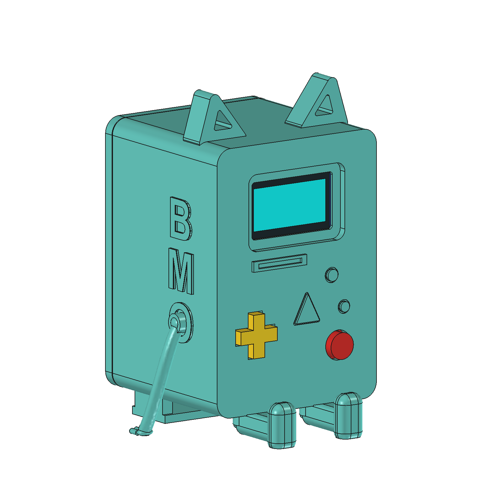
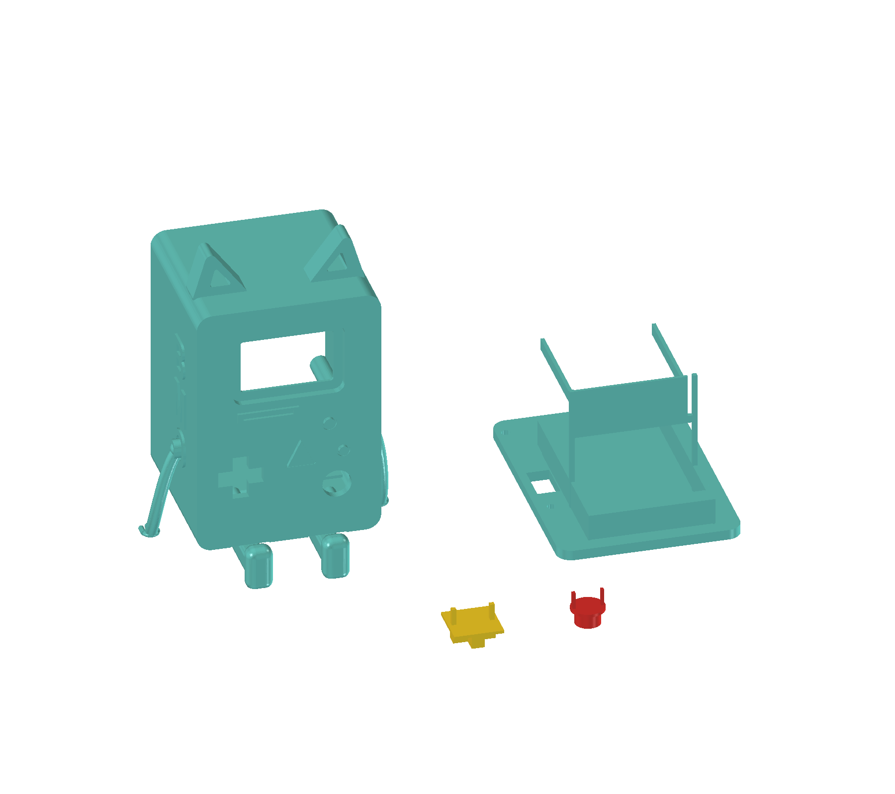

# BMO — Final Print Optimization

**Bản bàn giao hiện tại: `cad/print_shop/`. Phân loại: `DESIGN_REVIEW_REQUIRED`.**
Đã chỉnh trực tiếp bằng FreeCAD MCP trên assembly hiện có; không dựng lại BMO.

## File gửi tiệm và preview

- Gửi `cad/print_shop/BMO_SEND_TO_PRINT.zip`, hoặc 4 STL và `README_VI.txt` trong
  `cad/print_shop/SEND_TO_PRINT/`. Mỗi STL in một chiếc, mm, scale 100%.
- Mở `cad/print_shop/PREVIEW.html` để xem ảnh offline.
- CAD chỉnh sửa: `cad/print_shop/BMO_PRINT_SHOP.FCStd`.
- CAD xem riêng bốn part in: `cad/print_shop/BMO_FOUR_PRINT_PARTS_PREVIEW.FCStd`.
- STEP từng part và assembly: `cad/print_shop/step/`.

## Thay đổi đã chốt theo yêu cầu mới nhất

| Nội dung | Kết quả hiện tại |
| --- | --- |
| Chân | Lấy lại các khối chân từ `cad/final_print/LIVE_STATE_BEFORE.FCStd`; giữ dáng, tọa độ và phần bàn chân nhô như file tham chiếu |
| Chữ BMO | Hình chữ nổi gốc cao 10 mm, đúng tọa độ LIVE; cùng mint và gộp vào thân |
| Chữ O | Tâm Y=0, Z=29 mm, đồng tâm gốc tay |
| Tam giác và nút tròn | Dịch thêm +2 mm theo X so với bản tối ưu trước; D-pad và OLED giữ vị trí |
| Công tắc | Chuyển lên góc trên bên phải nắp lưng, tâm X=12, Z=66; actuator nhô 2 mm sau mặt nắp |
| Số part in | Đúng 4: thân, nắp, D-pad, nút đỏ |

Chân phải trong file tham chiếu là BRep đối xứng gây lỗi Boolean. Đã round-trip
STEP để sửa topology trước khi gộp, không vẽ lại chân; chênh thể tích BRep khoảng
0,0358 mm³ (khoảng 0,0041%). Peg cũ nằm trong root liền khối, không còn cơ cấu
lắp chốt rời. Body cuối là một solid. File tham chiếu và backup được giữ nguyên.

## Kích thước và bố trí linh kiện

Thân danh nghĩa **48 × 54 × 68 → 48 × 48 × 68 mm**, giảm sâu **6 mm (11,1%)**.
Lòng trong danh nghĩa **43 × 48,5 × 63 → 43 × 42,5 × 63 mm**, trước khi trừ giá.
Thành trước/nắp mẫu đo 2,75; hông/đáy/nóc 2,5; hông khắc DUT còn danh nghĩa 1,9 mm.
Các kích thước này không bao gồm bàn chân, tay, tai và nút nhô.

ESP populated 27 × 40,5 mm giữ nguyên, dịch 5,4 mm về trước. OLED không đổi.
Boost giữ hình học 37,2 × 17,2 với chiều cao placeholder 14 mm, xoay 90° đứng;
tụ Ø12,5 × 25 nằm ngang. Pin 503048 cùng PCM/dây/JST được giữ nguyên; pin và
cradle ESP đi với nắp. Không bỏ boost/tụ, không scale PCB hoặc cell.

So sánh cuối 544 tổ hợp mỗi family, sâu 38–54 theo bước 1 mm: boost nằm cần
51 mm trong lưới đã thử; boost đứng đạt 48 mm. 44 mm sơ bộ bị loại vì tụ dời
trước giao switch/retainer. Giới hạn hiện tại là tụ–boost–khay/pin, header ESP,
controls và khoảng chừa. Không khẳng định tối ưu toàn cục với mọi góc/xếp linh kiện.
`cad/final_print/depth-comparison-final.json` lưu so sánh; bản mới giữ cách xếp
được chọn, thay cơ cấu nút và vị trí switch.

Pin cách mặt phẳng trong nắp 1,65 mm; tụ 23 mm. Vách khay/gân chính đã tăng từ
0,5 lên 1,2 mm, khe ngang cell–khay danh nghĩa 0,3 mm mỗi bên. Sàn cradle ESP
0,8 mm. Dùng foam/đai mềm, không ép pouch bằng PLA. Chưa đo pack thật; không
suy độ an toàn cơ/điện/nhiệt từ nominal CAD.

## Bố cục nút và cơ cấu 4 part

D-pad tâm (-12,5;27), đỏ (12,5;21,5), tam giác tâm bbox (3;32), nút nhỏ trên
(10,5;39,4), nút nhỏ dưới (14,2;31), đơn vị X,Z mm. So với nguồn LIVE: D-pad
dịch trái 2; đỏ phải 3/lên 1; tam giác phải 3/lên 5; hai nút giả được điều chỉnh
đồng bộ. Các relief giả cùng mint, có rãnh sơn, không có switch hay lỗ xuyên.
Hai layout trước đã đo: A có D-pad–tam giác 4,5 mm, B bị loại do đỏ–nút nhỏ chỉ
1,43 mm. Dịch phải thêm 2 mm ở bản hiện tại tiếp tục tăng khoảng phía D-pad.

Chỉ D-pad và đỏ là nút thật. Shaft/hole clearance danh nghĩa 0,4 mm mỗi mép;
flange giữ phía trong. Hai cap có trụ chặn tích hợp tiếp xúc giá ở hành trình
0,30 mm; cap–stem nghỉ 0,05 mm, nén stem danh nghĩa 0,25. Đã kiểm 0–0,30 mm
không giao body, housing/giá/stem nén; kiểm kéo -0,05 và nhấn quá 0,35 để thấy stop.
Chưa kiểm lực, đàn hồi, nghiêng cap hoặc tuổi thọ với switch thật.

**Vật tư bổ sung để chỉ còn 4 STL:** hai miếng FR4/PCB đục lỗ 1,6 mm và bốn vít
M2 làm giá hai tactile. Đây là phương án cơ khí mặc định được chọn để thay part
nhựa giữ switch thứ năm. FR4 không xuất STL; có trong assembly STEP/CAD.
Footprint, cách hàn/giữ và hình dáng chân tactile phải đo; đây không phải thiết kế
PCB đã route hoặc mạch điện mới. Đo/fit coupon giá này trước khi in cả bộ.

## Gộp chi tiết và in FDM

Thân gộp hai tay, chân, hai tai rỗng, các nút giả, thanh ngang, chữ/hoa văn và
các giá cố định/skid. Nắp gộp khay pin/cradle ESP và giá công tắc sau lưng.
Không có STL riêng cho tay/chân/tai/chữ hoặc linh kiện điện tử.

Tai giữ lỗ cũ, viền mẫu đo 0,993 → 1,643 mm, sâu 5 → 7 mm; dưỡng Ø3 qua cả hai.
Tay giữ liền thân, root được gia cố; ngón vẫn nhỏ nên cần support và coupon.
Chưa có thử lực kéo khoen, bẻ tay/chân, rơi hoặc FEA. BMO theo source là chữ nổi;
DUT và duyaivy tiếp tục là rãnh khắc mint để tự sơn.

Hướng STL đã đặt trên Z=0: body đứng, nắp mặt ngoài xuống, cap mặt trước xuống
để các trụ chặn hướng lên. Hai cap cần tiệm xem support dưới flange; tay/ngón,
đáy thân và gân nắp cũng cần support chọn lọc. Thử nozzle 0,4, layer 0,16–0,20,
3–4 vách; đây chưa phải profile slicer đã chạy hoặc G-code. Gỡ support nhẹ,
giữ sạch mặt trượt và lỗ tai. In coupon trước khi in full để lắp.

## Kiểm chứng

`fit-validation.json`: 21 leaf parts có BRep hợp lệ, một solid mỗi part;
không có giao vật lý ngoài overlay OLED glass/active-area được phân loại rõ.
Antena, USB và khoảng thao tác switch không bị vật thể khác chiếm.
`saved-file-verification.json`: mở lại CAD đã lưu, kiểm đủ 4 part in và trục
vít giá FR4. `service-validation.json`: 8 bước tháo, kiểm BRep bước tối đa 0,5 mm,
không còn giao trên đường mẫu; không phải chứng chỉ chuyển động liên tục.

Thứ tự: ngắt dây/release đai và vít → rút nắp cùng ESP/pin/switch → charger →
boost → nhấc tụ 4 mm rồi rút → tháo giá D-pad (ra sau 4, lên 3, phải 4, rút sau)
→ giá đỏ (sau 0,2, lên 1,5, sau 4,8, trái 2, rút sau) → D-pad (sau 6, phải 4/
xuống 2, rút sau) → đỏ ra sau. Không kéo khi dây/adhesive còn giữ. Các vector và
điều kiện cụ thể nằm trong audit; cần xác nhận thao tác trên prototype.

| STL | Màu | Tam giác | Khối liên thông | Mặt tự giao theo PyMeshLab |
| --- | --- | ---: | ---: | ---: |
| `BMO_MAIN_BODY.stl` | mint | 39,086 | 1 | 0 |
| `BMO_BACK_COVER.stl` | mint | 4,944 | 1 | 0 |
| `BMO_DPAD_YELLOW.stl` | yellow | 92 | 1 | 0 |
| `BMO_BUTTON_RED.stl` | red | 1,036 | 1 | 0 |

STL đã đọc lại: kín, winding nhất quán và thể tích dương. Dùng PyMeshLab đóng
lỗ tessellation cục bộ, Manifold cleanup tolerance 0,01 mm cho thân, 0,005 mm
cho các part khác; không sửa CAD bằng mesh. Chân và chữ theo tham chiếu được
giữ trong CAD; STL là tessellation có sai số được kiểm riêng.
Khoảng cách Hausdorff lấy mẫu hai chiều tới tessellation nguồn lớn nhất
**0.01647 mm**; đây là phép lấy mẫu, không phải bound toàn bề mặt.
FreeCAD không báo self-intersection trên các STL cuối.
Các filter được mô tả trong [tài liệu PyMeshLab](https://pymeshlab.readthedocs.io/en/latest/filter_list.html).
`mesh-validation.json` lưu phiên bản công cụ, checks, bounds, transform và SHA-256.

## Còn cần đo và thử

Pack 503048 cả bọc/PCM/JST; camera/header ESP thực (nguồn giả định camera đã
tháo); PCB/kính/header OLED; boost/trimmer/chân hàn; tụ/lead/cực tính/rating;
charger/USB và switch thật; hai tactile/footprint/height/travel/force; vít,
foam/đai và đủ số lõi dây/đầu nối/bend radius. Các hành lang dây trước chỉ là
dự phòng, chưa chứng minh harness hoàn chỉnh; vị trí switch mới cần route dây
đúng thực tế. Chưa có thử nhiệt/điện hoặc cấp nguồn từ xa.

Không dùng `PRINT_READY`: mesh đạt không chứng minh fit, độ bền, retention hoặc
nguồn điện. `DESIGN_REVIEW_REQUIRED` là trạng thái của bộ in thử này; nâng mức
sau khi đóng số đo quyết định và in/lắp coupon đạt.

## Source để chỉnh tiếp

Nguồn hình học ban đầu và backup giữ ở `cad/final_print/`; các stage trong CAD
và script FreeCAD MCP giữ khả năng tái tạo. BRep không phải toàn bộ sketch có
constraint tự recompute; sửa JSON/spreadsheet phải chạy lại generator tương ứng.
Pipeline bản mới: `revise_bmo_print_shop.py` → `check_bmo_shop_revision.py` →
`mount_bmo_shop_switches.py` → `repair_bmo_reference_foot.py` →
`restore_bmo_live_style.py` → `export_bmo_shop_source.py` →
`validate_bmo_shop_service.py` → `prepare_bmo_shop_meshes.py` →
`verify_bmo_shop_saved.py` → `package_bmo_print_shop.py`.
Chờ từng job MCP xong trước bước phụ thuộc; các đường dẫn workspace trong source
cần điều chỉnh nếu chuyển máy. Không ghi đè thay đổi thủ công chưa lưu phiên bản.

